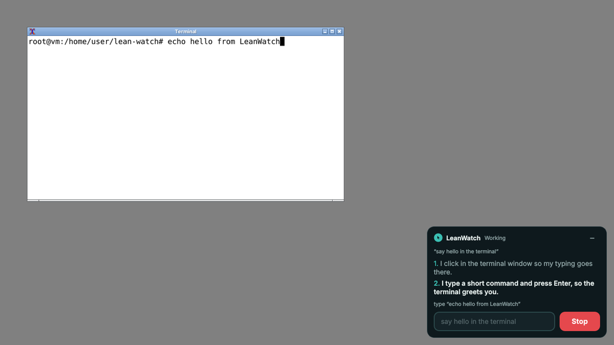
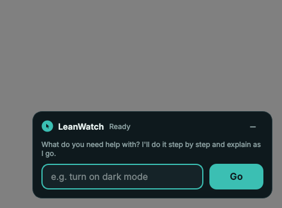
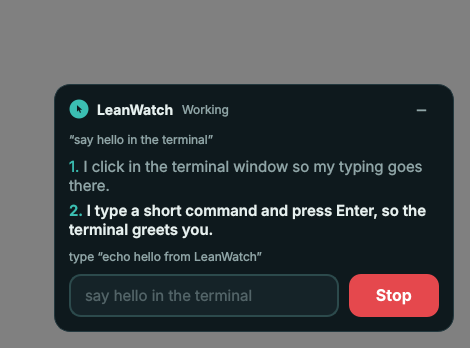
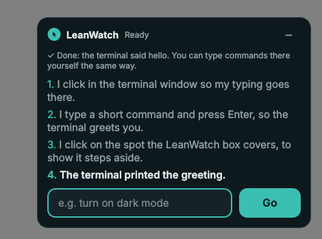

# LeanWatch

A small teal cursor bubble floats on top of every app on your computer. When you need help, click it: it opens into a box where you type what you want to do ("turn on dark mode", "make this photo black and white"). Then lean back and watch. LeanWatch moves the mouse, clicks and types for you, and explains every step in plain words so you can do it yourself next time.

It is for people who find video tutorials hard to follow: editing a photo, rotating a model in a 3D app, using the command prompt, or just finding a setting.



| Closed: a bubble on top of every app | Click it: type what you need | It works and explains each step | Done, with a summary |
| --- | --- | --- | --- |
|  |  |  |  |

*(Screenshots of the real app, taken on a Linux desktop during an automated test.)*

The project has three parts:

| Part | What it does | Needs |
| --- | --- | --- |
| `agent/` desktop helper | The floating bubble and its command box, and the agent that controls your **real** mouse and keyboard with an open vision-language model running on your computer | Python 3.10+, about 6 GB of GPU memory (or more RAM and patience). No API key |
| `training/` | Records training data, imports public GUI datasets, and fine-tunes the open model with LoRA / QLoRA | A GPU for real runs; see [training/README.md](training/README.md) |
| `web/` practice computer | A pretend desktop in the browser with five apps, for trying LeanWatch safely and for recording training data; also shows build progress | Just a browser: https://bluestonerealty2026-a11y.github.io/lean-watch/ |

## Install and start

```bash
cd agent
pip install -r requirements.txt         # with an NVIDIA GPU, install the CUDA build of torch first
python -m leanwatch                     # the teal bubble appears in the bottom-right corner
python -m leanwatch --autostart on      # optional: start it every time you log in
```

1. Click the bubble, or press <kbd>Ctrl</kbd>+<kbd>Alt</kbd>+<kbd>Space</kbd> anywhere (<kbd>Ctrl</kbd>+<kbd>Shift</kbd>+<kbd>Space</kbd> on a Mac).
2. Type what you need and press <kbd>Enter</kbd> or **Go**.
3. The first time, LeanWatch asks to use your mouse and keyboard. Click **Allow for this session**.
4. Watch. Each step appears in the box. LeanWatch asks before anything that is hard to undo.
5. **Stop** (or <kbd>Esc</kbd>) ends it at once. Moving the mouse yourself pauses it.

Drag the bubble anywhere; it remembers the spot. Right-click it to hide it (the shortcut brings it back), move it back to the corner, or quit.

The first task downloads [UI-TARS-1.5-7B](https://huggingface.co/ByteDance-Seed/UI-TARS-1.5-7B) (Apache-2.0, about 16 GB) from Hugging Face. Everything then runs on your computer: no API key, and no screenshots leave the machine. On an NVIDIA GPU with less than 24 GB, add `--4bit` (`pip install bitsandbytes` first) to fit it in about 6 GB. On an Apple Silicon Mac it runs on the GPU (`mps`) as is. `--preload` loads the model at start-up so the first task starts quickly.

| Option | What it does |
| --- | --- |
| `--hotkey "ctrl+alt+l"` | A different shortcut to open the box (`none` turns it off) |
| `--autostart on` / `off` | Start LeanWatch, with the other options you give, every time you log in |
| `--dry-run` | Plans and explains on your real screen but never moves the mouse or presses keys. Start here. |
| `--speed 0.6` | Slower pointer, easier to follow |
| `--adapter runs/my-model` | Use a model you fine-tuned with `training/train_sft.py` (it remembers its own settings) |
| `--model` | Another Hugging Face model id or a local folder (default `ByteDance-Seed/UI-TARS-1.5-7B`) |
| `--device`, `--max-pixels` | Where the model runs (`auto`, `cuda`, `mps`, `cpu`) and the largest screenshot it sees |
| `--language Spanish` | Language of the explanations |
| `--web` | Also open the web control center (live screenshots, step log) |
| `--no-bubble` | Web control center only, no bubble |
| `--cli "task"` | Run one task in the terminal |
| `--brain claude` | Optional: use the Claude API instead (`pip install -r requirements-claude.txt`, needs `ANTHROPIC_API_KEY`) |

### Your operating system

- **Windows 10/11**: works as is: no permissions to grant. The bubble stays above other windows (not above the Start menu, the lock screen or exclusive-fullscreen games) and on every virtual desktop. On Windows 10 version 2004 or newer it is invisible in screenshots, so the model never sees it. LeanWatch can't control apps that run as administrator, unless it runs as administrator too.
- **macOS**: allow your terminal (or Python) under System Settings → Privacy & Security → **Accessibility** (to move the mouse and for the shortcut) and **Screen Recording** (to take screenshots), then restart it. Install `pyobjc-framework-Cocoa` (included in `requirements.txt` on macOS) so the bubble floats over full-screen apps and on every Space.
- **Linux**: works on X11 desktops (GNOME on Xorg, KDE, Xfce, …). Under Wayland, LeanWatch runs through XWayland, and some desktops keep native Wayland apps above it; log in with an "Xorg" session for full control.

## Safety

- Nothing moves until you grant permission, and you choose pointer and keyboard separately.
- Stop at any time: **Stop** or <kbd>Esc</kbd> in the box, or push the mouse into a screen corner (pyautogui's fail-safe).
- If you move the mouse yourself, the agent pauses and waits for **Resume**.
- Deleting, sending, buying, installing and changing security settings need your **Allow**. Typed text that looks destructive (`rm -rf`, `format`, `sudo`, …) is held back for approval even if the model didn't ask.
- Text on web pages and in documents is treated as information, never as instructions, to resist prompt injection.
- The box never shows up in the model's screenshots or under its clicks: the operating system leaves it out of screenshots where it can, and otherwise it steps aside for a moment.
- After you click in the box during a task, the keyboard goes straight back to your app, so LeanWatch's typing never lands in the wrong place.
- The agent listens only on `127.0.0.1`, rejects other Host headers and other websites' origins, and needs a random session token that only the page it opens (and `~/.leanwatch/session.json`, mode 600) knows.

## How it works

The practice screen and your real computer run the same loop a robot does: **look** at the screen, **decide** the next move, **act**, then **check** the result.

```
web/
  index.html           control center page
  css/styles.css
  js/simos.js          practice computer: windows, taskbar, shared files, settings
  js/apps/*.js         Settings, PhotoLab, Blocks3D, Command Prompt, Files
  js/cursor.js         pointer motion: Fitts's law timing + minimum-jerk Bezier path
  js/planner.js        TF-IDF nearest-neighbour intent classifier, slot filling, 29 skills
  js/agent.js          runs plans by moving, clicking, typing and dragging; "Now you try" coaching
  js/bridge.js         WebSocket link to the local agent
  js/progress.js       build tracker and live checks
  js/main.js           wiring
  tests/smoke.mjs      Playwright end-to-end test

agent/leanwatch/
  bubble.py            the floating bubble and command box (Qt), and the shield that keeps them out of the model's way
  native.py            per-OS details: stay on top everywhere, screenshot exclusion, keyboard hand-back, shortcut
  desktop.py           runs the bubble (main thread) and the agent server (background thread)
  autostart.py         start at login on Windows, macOS and Linux
  local_brain.py       default brain: open GUI model on this computer (screenshot -> Thought + Action)
  actions.py           UI-TARS action language: parse answers, write training targets, coordinate spaces
  local_prompts.py     the prompt and conversation, shared by training and the agent
  brains.py            picks the brain; reads a fine-tuned model's saved settings
  brain.py             optional Claude computer-use brain
  controller.py        executes the 17 computer-use actions with pyautogui
  screen.py            screenshots, scaling and coordinate mapping
  permissions.py       consent scopes and risky-action rules
  risk.py              spots hard-to-undo steps in the model's explanation (6 languages)
  server.py            the agent session; aiohttp server for the optional web control center
  __main__.py          command line

training/              data engine, dataset importers, LoRA/QLoRA fine-tuning, evaluation
```

- **Practice screen**: the planner matches your sentence to the closest example sentence of each skill (cosine similarity of TF-IDF vectors), pulls out details like numbers, names and colours, and builds a list of steps. The executor only acts through the pointer: it moves to a point and clicks whatever is under it, as a person would.
- **Your computer**: `local_brain.py` gives the model the task and the last three screenshots. The model answers in the UI-TARS action language, for example `Thought: The Display page is open, so I click the Dark mode switch.` then `Action: click(start_box='<|box_start|>(822,231)<|box_end|>')`. LeanWatch shows the thought to you, maps the point from the model's resized image back to your screen, and `controller.py` moves the real pointer along the same human-like path. A step whose thought mentions deleting, sending, buying, installing and the like needs your Allow even if the model forgot to ask (`ask_user`).
- **Training your own**: `training/record_practice.mjs` drives the practice computer in a headless browser and records every step (screenshot, instruction, explanation, action). `build_dataset.py` turns recordings and public datasets into chat examples, `train_sft.py` fine-tunes UI-TARS-1.5 with LoRA or QLoRA (TRL), and `evaluate.py` measures click-inside-target accuracy before and after. The full guide, with model and dataset choices per GPU, is in [training/README.md](training/README.md).

## Tests

```bash
cd agent && pip install -r requirements-dev.txt && python -m pytest   # no API key, display or model download needed (the bubble runs offscreen)
cd training && python -m pytest                                       # whole training pipeline with a tiny model on CPU
npm install && npm test                                               # 26 browser checks on the practice screen
```

## Publishing

`.github/workflows/static.yml` publishes the `web/` folder to GitHub Pages on every push to `claude/bold-bell-tq6s9b` (the default branch; add others to `on.push.branches`). It first serves the exact files under `/lean-watch/` and runs the browser smoke test against them, so a broken page is never deployed. In the repository's Settings → Pages, **Source** must be **GitHub Actions**.

## Roadmap

Open the **Build progress** tab for the live list. Next: the first live run on real Windows, macOS and Linux desktops, the first full fine-tune of UI-TARS-1.5-7B on a GPU, support for newer Qwen3.5-based GUI models, reinforcement learning with the practice computer as the environment, and benchmarks (ScreenSpot-Pro, OSWorld-G).
